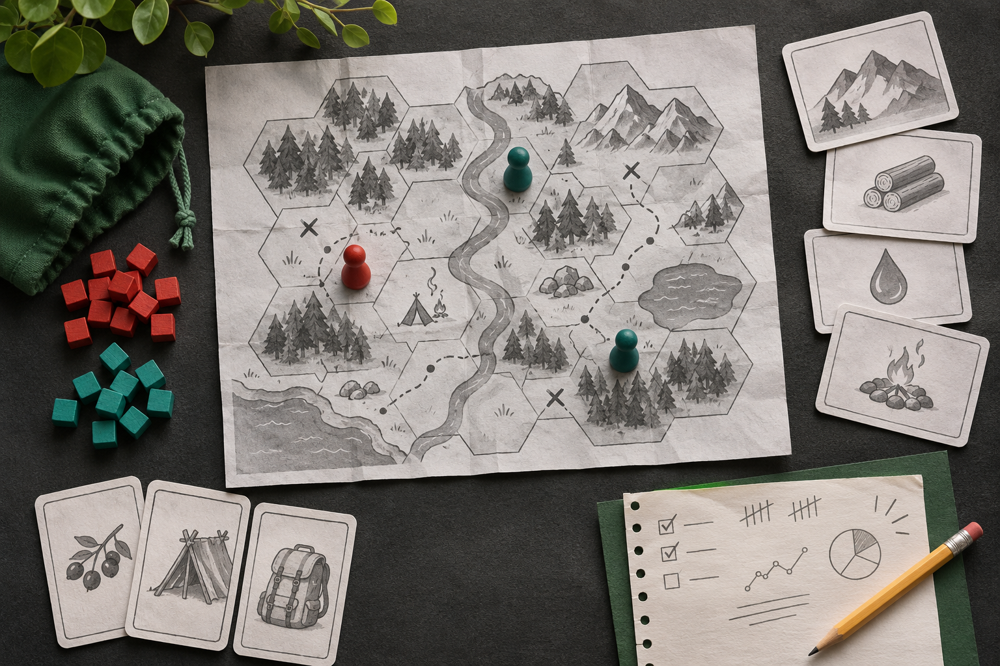
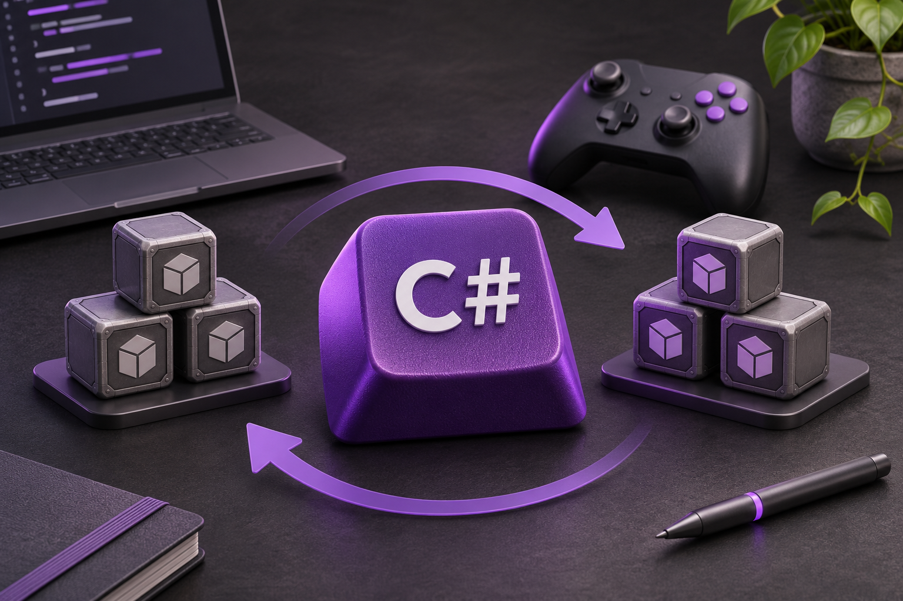
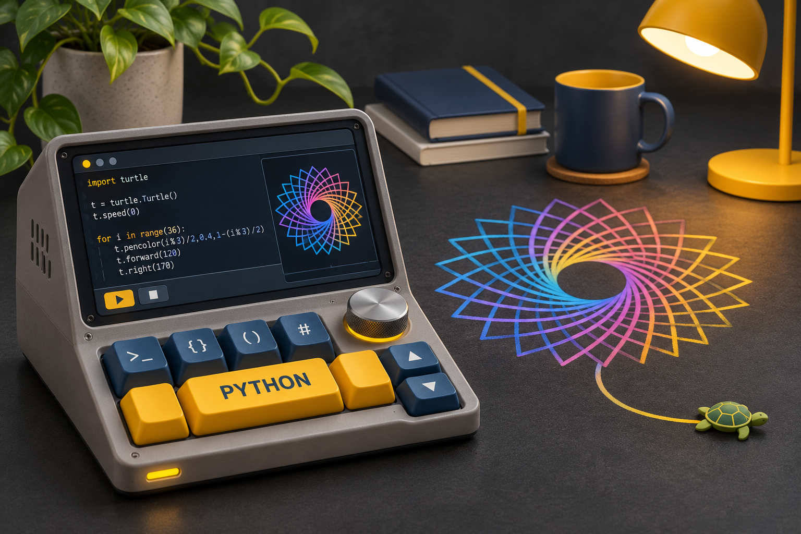

<h1 align="center">Hi, I'm Jaehoon (JH) 👋</h1>

<b>🎮 Game Contents Student | Game Design & Gameplay Programming</b>

I'm a Game Contents student interested in game design and gameplay programming. I enjoy building prototypes, playtesting, and improving games.

---

## 🎲 Survival Board Game Prototype

  

I worked with my team to playtest a survival board game using a black-and-white printed prototype. We discussed issues during play and revised the draft together.

- 🎯 Focus: Game rules, balancing, and playtest feedback.

---

## 🎮 C# for Game Development

  

I'm studying C# and design patterns for game development.

- Factory Pattern
- Object Pooling
- Observer Pattern

---

## 🐍 Python Practice

  

I practice Python through small hands-on projects, including Turtle graphics and a BMI calculator.

- Functions and user input
- Conditionals and formatted output

---

## 🤝 Collaboration & Feedback

- 👯 I'm open to collaborating on small game projects and gameplay prototypes.
- 💬 Ask me about board game prototyping, playtesting, or C#.
- 📫 For project questions or feedback, open an issue in the relevant repository.

<!-- Upload boardgame.png, csharp.png, and python.png to the assets folder. -->
